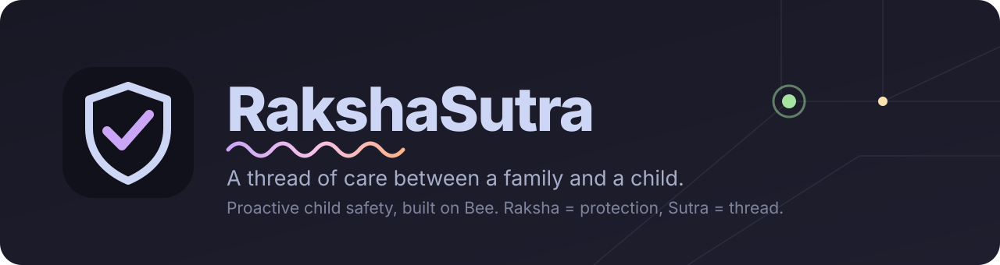
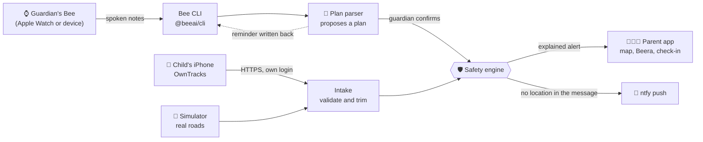

<div align="center">



<br>

[](https://amazonappdev2026.devpost.com/)
[](https://docs.bee.computer)
[](#aws)
[](LICENSE)


**[▶️ Watch the 3-minute demo](https://youtu.be/BaXYOOYGe1A)** · **[Quick start](#-quick-start)** · **[How it works](#-how-it-works)** · **[Real use](docs/REAL_USE.md)** · **[Safety engine](#-safety-engine)** · **[Privacy](#-privacy-and-security)** · **[Authors](#-authors)**

</div>

---

## 🛡️ What is RakshaSutra?

*Raksha* means **protection** and *sutra* means **thread**: a thread of care between a family and a child who is out in the world.

Most child-safety devices wait for a child to press a button. RakshaSutra does not wait. It **listens for the plan**, **watches for the unexpected**, and **tells the parent early, with the reasons**. It started as a student's school-project idea that relied on passive RFID tags, and became a proactive companion built on a **Bee wearable**.

> *"Adam has CTE class today, so I'll pick him up from the school at 5 p.m."*
> Bee hears it → RakshaSutra proposes a plan → the guardian confirms → the safety engine judges the child's location reports against that plan. An alert fires **only when something is actually unexpected**, and it always says what was expected, what is known and **what is not known**.

| | |
|---|---|
| 🐝 **Bee supplies context** | Schedules and changes from the guardian's spoken notes, read live through the official Bee CLI library, plus a reminder written back to Bee todos once a plan is confirmed. |
| 📍 **A separate, labelled feed supplies location** | Bee is not a child GPS tracker and is rated for adults, so the child's position comes from his own iPhone (OwnTracks) or the built-in simulator. The app always says which source it is showing. |
| 🧭 **Plans, not guesses** | A late arrival is a calm "worth a look", never a claim of danger. Missing data is never presented as confirmed danger. |
| 🐝 **Beera** | The friendly bee mascot (the name means courage and strength) says what is going on in plain words. |

---

## 🚀 Quick start

<details open>
<summary><b>▶️ Run the demo (no accounts needed)</b></summary>

<br>

Requirements: **Node.js 20 or newer**.

```bash
npm install
npm test                                  # 75 unit tests
npm run build -w @rakshasutra/web
npm run start -w @rakshasutra/server      # the whole app on http://localhost:8787
```

Open <http://localhost:8787>, open **Demo controls**, choose **The unexpected delay**, and press **Start scenario**. Without a connected Bee the story plays scripted notes, and the app labels them. For development with hot reload run `npm run dev:server` and `npm run dev:web` (<http://localhost:5173>).

</details>

<details>
<summary><b>🧪 Play a child's phone along real roads (the simulator)</b></summary>

<br>

The simulator replays a child's iPhone into a private real-mode copy of the app, along real roads and footpaths, and reads your live Bee when the Bee CLI is installed.

```bash
npm run setup:real -- --name Adam --age 13     # once: creates the private data/ folder and the family code
npm run sim:serve                               # private simulator server on :8788
npm run sim -- school-run                       # in another window
```

| Scenario | What happens |
|---|---|
| `school-run`, `pickup` | A parent drops off or collects the child along the real roads. Nothing to worry about. |
| `late`, `arrive` | The child does not head home after class, the alert fires, then he is collected and the plan completes. |
| `wrong-place` | The child walks into a parent-flagged area. |
| `sudden-stop` | Walking, then vehicle speed away from a pick-up point, then an abrupt stop. |
| `no-movement`, `signal-lost` | Hours without moving, or without a signal (back-dated and played instantly). |

Full details in [docs/REAL_USE.md](docs/REAL_USE.md).

</details>

<details>
<summary><b>🐝 Connect your own Bee</b></summary>

<br>

1. In the Bee phone app, enable **Developer Mode** (tap the app version 5 times in Settings).
2. Install the Bee CLI. On Windows the npm package has no binary: download `bee-windows-x64.zip` from the bee-cli GitHub releases, unzip it into `tools/bee-cli/` (git-ignored) and set `BEE_CLI_BINARY` to the `bee.exe` path. See [docs/FRICTION_LOG.md](docs/FRICTION_LOG.md).
3. `bee login`, then `bee status`.
4. Start the server with `BEE_NOTES=1`. When the chip shows **Bee: live**, say a schedule note aloud and a proposed plan appears. (`npm run sim:serve` does this automatically when the CLI is in `tools/bee-cli/`.)

</details>

<details>
<summary><b>⚙️ Configuration (environment variables)</b></summary>

<br>

| Variable | Effect |
|---|---|
| `BEE_NOTES=1` | Start the Bee bridge: stream the guardian's utterances, write reminders |
| `BEE_CLI_BINARY` | Path to the `bee` binary (default: `bee` on PATH) |
| `BEE_RAW_LOG=1` | Log raw Bee stream events. This writes everything the Bee hears to the log; keep it off unless debugging |
| `BEE_ALERTS=1` | Also send critical alerts to the guardian's Bee as reminders |
| `NTFY_TOPIC` | Push alerts to the parent through ntfy.sh. Messages contain no location and no name |
| `SNS_TO_PHONE` | Text critical alerts to the parent's own phone through Amazon SNS (needs `@aws-sdk/client-sns`) |
| `BEDROCK_MODEL_ID` | Reports and answers are written by Amazon Bedrock; otherwise a template is used |
| `AWS_REGION` | Bedrock region (default `us-east-1`) |
| `PARENT_TOKEN` | Demo parent credential (default `demo-parent`, demo mode only) |
| `FORCE_DEMO=1` | Run the demo even if a private `data/` folder exists |
| `PORT`, `HOST` | Listen port (default 8787) and address (default `127.0.0.1`: this computer only) |
| `DATA_DIR` | Where the private family data lives (default `data/`) |

</details>

---

## 🧩 How it works



<details>
<summary><b>📁 Project layout</b></summary>

<br>

| Folder | What is in it |
|---|---|
| `packages/core` | Types, geo maths, the anomaly engine, plan parser, SOS and report builders, OwnTracks translation, the demo simulator. No I/O, fully unit tested |
| `apps/server` | Hono API, the Bee bridge, real-mode setup and intake, alert channels, demo runner, Bedrock narrator |
| `apps/web` | React + Leaflet parent app (Catppuccin colours, expanding sheets, hash routes) |
| `scripts` | `e2e.mjs` (demo API), `e2e-real.mjs` (real mode), `sim.mjs` (phone and road simulator), `publish-public.mjs` |
| `docs` | `requirements.md`, `design.md`, `REAL_USE.md`, `DEMO_SCRIPT.md`, `FRICTION_LOG.md` |
| `infra` | Reserved for the AWS CDK stack (not built yet) |

</details>

<details>
<summary><b>🐝 What Bee gives us, and what it does not</b></summary>

<br>

| Capability | Status |
|---|---|
| Guardian's spoken notes | ✅ `bee stream` utterances, read live and used |
| Write a reminder back | ✅ `bee todos create --alarm-at`, used after a plan is confirmed |
| Location of the Bee wearer | ⚠️ The `update-location` event exists; accuracy and frequency are not documented, so the child's feed does not depend on it |
| Heart rate, motion, battery | ❌ Not documented for Bee. Simulated in the demo and labelled; an iPhone has no heart rate |

</details>

---

## 🚨 Safety engine

Watch is **1** point, warning **3**, critical **6**. The tier is the sum. Alerts fire at warning and above, with a cooldown and escalation, and follow-ups for the same emergency are grouped into one incident.

<details>
<summary><b>📋 Every signal and its points</b></summary>

<br>

| Signal | Points | Notes |
|---|---|---|
| ⏰ Expected check-in missed | 3, then 6 | Needs a confirmed plan. Says what was expected and what is unknown. Place enter and leave events from the phone count as truth |
| 🚗 Walking to vehicle speed | 6 | Skipped at known pick-up points |
| 📵 Phone or band silent | 3, then 6 | Slower inside a safe place |
| 🛑 Sudden stop | 3 | 8+ m/s to under 1 m/s |
| ❤️ Heart rate over 180 or under 30 | 6 (3 if running) | Only when a source supplies it |
| ⚠️ In a flagged area | 3 (6 if high) | Advisory only |
| 💤 Not moving for 3 hours | 3 | Suppressed in safe places |
| 🌙 Left a safe place at night | 3 | Quiet hours |
| 🔋 Battery 10% or less | 1 | |

In real mode with a plain iPhone the rules that cry wolf on a real child (school-bus speed, a friend's house, GPS jitter, no heart rate) are **off by default** and can be changed in the private `family.json`.

</details>

<details>
<summary><b>📨 What the parent receives when something goes wrong</b></summary>

<br>

The parent is messaged without opening the app: a new message, updates as things change, and reminders until acknowledged. Each message carries the reason, a plain-language place, a 3-hour timeline, speed and heading, battery, **what is not known**, nearest help, backup contacts and a short brief to read to a dispatcher. A read-only 2-hour link can be created for a responder (position and movement only).

> [!IMPORTANT]
> **Emergency numbers are display-only.** The app never dials them or messages them, in tests or demos. Every channel refuses them as a destination, and they cannot be saved as family contacts.

</details>

---

## 🔒 Privacy and security

<details open>
<summary><b>How the child's data is protected</b></summary>

<br>

| | |
|---|---|
| 🔑 **Parent-only** | Everything is behind a long family code, compared in constant time, with failures rate-limited (10 a minute, then a one-minute block). The phone has its own separate, send-only login. |
| 🏠 **Local first** | The server listens on this computer only. The phone and visitors reach it through your own tunnel. The family profile, access codes, child's photo and saved day live in the git-ignored `data/` folder with restricted permissions. |
| 🧱 **Hardened intake** | The OwnTracks endpoint validates and trims every field, limits size and drops anything unknown. The web app is served with a strict Content-Security-Policy, no framing, no sniffing and `no-store`. |
| 🤫 **Minimal alerts** | Push messages contain no location and no name by default. The Bee bridge keeps only schedule proposals, never other speech. |
| 🙈 **No secrets in the repo** | Never commit `data/`, `data-sim/`, `tools/` or any login link. `.gitignore` covers them, and the publish script refuses to continue if it finds a secret. |
| 🤝 **Consent** | Tell the child it is on and what it sees. The simulator and the demo video use a fictional or blurred map. |

</details>

<details>
<summary><b>🚫 Not built, on purpose</b></summary>

<br>

Alerting nearby strangers who own a Bee: there is no supported API for it, and it would expose a child's identity and location. The roadmap is a parent-curated trusted circle and a handoff packet to emergency services.

</details>

---

## ✅ Honest status

<details>
<summary><b>What is built, tested, and not yet verified</b></summary>

<br>

| | |
|---|---|
| ✅ **Built and tested** | The engine, plan parsing from real Bee transcripts, the live Bee bridge, real-mode intake and setup, the simulator, the parent app. Three suites: **75** unit tests, **37** demo API checks, **28** real-mode checks (`npm test`, `npm run e2e` against a demo-mode server, `npm run e2e:real`). |
| 🧪 **Not yet verified** | A run with a real iPhone moving through OwnTracks, and the Bedrock narrator against a real AWS account. |
| 🗺️ **Next** | A CDK stack (API Gateway, Lambda, DynamoDB, SNS, Bedrock) and a native iPhone app. |

</details>

### AWS

Amazon Bedrock writes the reports and plain-language answers when `BEDROCK_MODEL_ID` is set, and Amazon SNS can text the parent's own phone. Both are optional and off by default; the app falls back to templates. A CDK stack is planned in `infra/`.

---

## 👥 Authors

<table>
  <tr>
    <td align="center" width="50%">
      <b>Gaurav Johari</b><br>
      Builder and the adult entrant<br><br>
      <a href="https://github.com/gauj"></a>
    </td>
    <td align="center" width="50%">
      <b>Ayaan Johari</b><br>
      Original idea and co-author<br><br>
      <a href="https://github.com/Brave-Ayaan"></a>
    </td>
  </tr>
</table>

RakshaSutra began as Ayaan's school-project idea for child safety, and grew into a working app with his father. Ayaan is a co-author of the idea and the project. The hackathon entry itself is submitted by Gaurav, because the rules require entrants to be adults.

## 📄 Licence

[MIT](LICENSE) © 2026 Gaurav Johari. Free to use, study and build on.

<div align="center">
<br>

<br>
<sub><i>A thread of care.</i></sub>
</div>
