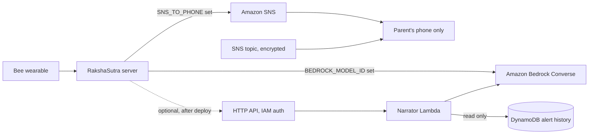

# AWS in RakshaSutra

This page says what AWS is used for, how to turn it on, and exactly how much of it has been run. It is written for judges of the AWS Builder mini challenge, so it separates "the code exists and is tested with mocks" from "it ran on AWS".

## Status (read this first)

| Item | Status |
| --- | --- |
| Bedrock Converse narration and Q&A implemented (`apps/server/src/narrator.ts`) | Yes |
| SNS text message to the parent implemented (`apps/server/src/channels.ts`) | Yes |
| Both unit-tested offline with mocked AWS SDK clients (13 tests) | Yes |
| CDK stack written (`infra/`, DynamoDB + SNS + Lambda + HTTP API) | Yes |
| CDK stack tested offline with `aws-cdk-lib/assertions` (9 tests) | Yes |
| `cdk synth` succeeds | Yes |
| Deployed to a real AWS account | **No** |
| Live Bedrock call made | **Attempted, not successful.** On 23 Oct 2026, with a brand-new account, a least-privilege IAM user and `scripts/bedrock-check.mjs`, AWS accepted the credentials and region but answered "Operation not allowed" (first "account is currently being verified"), for both `amazon.nova-lite-v1:0` and `us.amazon.nova-lite-v1:0`. The app fell back to its template, as designed. This is an AWS account-activation block, not a code error. |
| Live SNS message sent | **No** |
| Narrator Lambda executed (even locally) | **No**. Only its CDK packaging was synthesised; its code has no tests. |
| Kiro Crew used in development | **No**. The AWS Builder challenge suggests it; it was not used. |

The mocks prove the code builds the right request (model id, system prompt, low temperature, parent-only destination). They do not prove that AWS accepts the request. Treat first deployment as untested.

## What is used

1. **Amazon Bedrock (Converse API)** writes the parent's summary and answers free-form questions. The prompt tells the model to use only the supplied JSON facts, to say so when coverage is low, and to lead with whether the parent must act. Temperature is 0.2. Without Bedrock the app uses a built-in template, and the screen says which engine wrote the text (`bedrock` or `template`).
2. **Amazon SNS** sends a text message to the **parent's own phone** for critical alerts.
3. **CDK stack `RakshaSutraStack`** (in `infra/`) defines the cloud side: a DynamoDB alert-history table, an SNS topic, a narrator Lambda that calls Bedrock, and an HTTP API in front of it.

### Product rule: emergency services are never contacted

Emergency numbers (911, 112, 100 and similar) are display-only. The app never dials or messages them.
- `smsChannel` refuses any emergency number as a destination and never calls SNS.
- The CDK stack refuses an emergency number as `parentPhone` at synth time.
- SNS is only ever pointed at the parent's own number or topic subscription.

## Architecture



Solid arrows are what the local server does today when configured. Dotted and the Lambda/DynamoDB/topic boxes are defined in CDK but not deployed or wired into the server yet: the server does not write to DynamoDB or publish to the topic.

## Turn it on locally

You need AWS credentials in the usual places (environment variables, `~/.aws`, or SSO). None are stored in this repo.

| Feature | Set | Notes |
| --- | --- | --- |
| Bedrock narration and Q&A | `BEDROCK_MODEL_ID` (for example `amazon.nova-lite-v1:0`) | Enable model access for that model in the Bedrock console first. Some models need a cross-region inference profile id such as `us.anthropic...`. |
| Region | `AWS_REGION` | Defaults to `us-east-1`. |
| SMS to the parent | `SNS_TO_PHONE` (E.164, for example `+14155550123`) | Must be the parent's own number. New SNS accounts start in the SMS sandbox, so verify the number first. |

`@aws-sdk/client-sns` is loaded lazily and is not listed in `apps/server/package.json`; install it (`npm i @aws-sdk/client-sns -w @rakshasutra/server`) before using SMS. If it is missing the channel reports "SNS unavailable" and nothing is sent.

## Run the offline checks

```
npm test --prefix apps/server        # 13 tests, mocked Bedrock and SNS
npm install --prefix infra           # once
npm test --prefix infra              # 9 tests on the synthesised template
cd infra && npx cdk synth            # writes infra/cdk.out, needs no credentials
```

The server tests use the Vitest binary installed under `packages/core` (see `apps/server/package.json`), so run `npm install` at the repo root first.

## Deploy (only when you have an AWS account)

Not done by the author. The commands are standard CDK:

```
cd infra
npx cdk bootstrap                                  # once per account and region
npx cdk deploy                                     # no alert subscription
npx cdk deploy -c parentPhone=+14155550123         # or -c parentEmail=you@example.com
npx cdk deploy -c bedrockModelId=amazon.nova-lite-v1:0
```

With no context value, the topic has no subscribers. Outputs: `ApiUrl`, `TableName`, `TopicArn`. Calls to `POST /narrate` must be signed with SigV4 (for example `awscurl`), body `{"template": "...", "facts": {...}, "question": "optional"}`. If Bedrock fails the Lambda returns the supplied `template` text.

To remove it: `npx cdk destroy`. The DynamoDB table has a RETAIN policy and survives; delete it by hand if you want it gone.

## Cost notes

Nothing is always-on. DynamoDB is pay-per-request, Lambda and HTTP API bill per call, SNS and Bedrock bill per message or token. The API stage is throttled to 5 requests per second (burst 10). Idle cost is close to zero apart from point-in-time recovery storage on the table and CloudWatch logs (kept one month). SMS prices vary by country; check the SNS pricing page. These are design intentions, not measured bills.

## IAM least privilege

- Narrator Lambda role: `bedrock:InvokeModel` on the one configured foundation model ARN (or the one inference profile plus its underlying model), and DynamoDB read actions on the one table. No wildcard actions. The only wildcard is the region segment of the underlying-model ARN when an inference profile is used, because profiles route across regions.
- Converse is authorised by `bedrock:InvokeModel`.
- The API uses `AWS_IAM` authorisation: callers need `execute-api:Invoke` on the API. There are no API keys to leak.
- Table is encrypted with the AWS managed key, the topic with the AWS managed SNS key (`alias/aws/sns`). Resources are tagged `project=rakshasutra`.
- Caveat: an SNS topic encrypted with the AWS managed key cannot receive events from some AWS services (for example CloudWatch alarms). Switch to a customer managed key if you need that.

## Known gaps

- The Lambda uses Node 20 as specified, but `cdk synth` warns that AWS deprecated `nodejs20.x` (creation disabled from 2027-02-01). Change `NODEJS_20_X` to a newer runtime before a real deploy.

- The server does not yet store alerts in DynamoDB or publish to the topic; the stack is the target design.
- The narrator Lambda code is untested. Its behaviour mirrors `narrator.ts` but is not covered by the mocks.
- `design.md` section 9 lists further ideas (EventBridge, Cognito, Location Service) that are not built.
